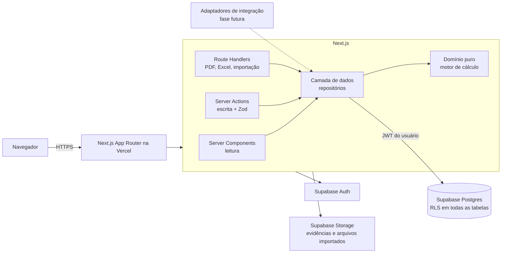
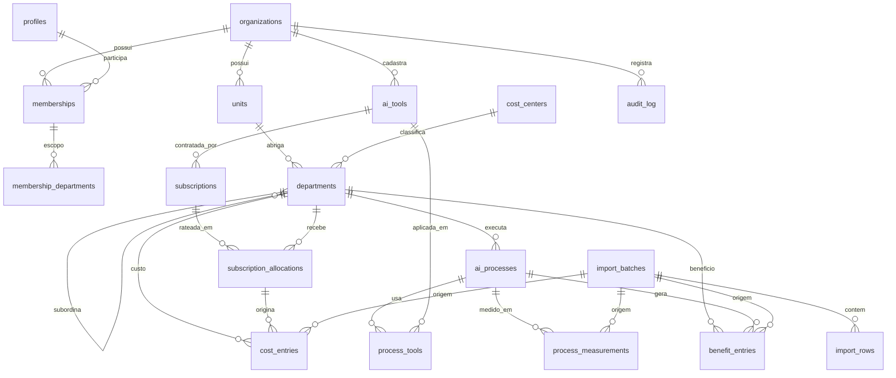

# AI ROI Controller — Fase 1: Arquitetura e Planejamento

> Status: **aguardando aprovação**. Nenhuma tela ou código de aplicação foi criado.
> A implementação (Fase 2) só começa depois da aprovação deste documento e das
> decisões listadas na seção 10.3.

Princípio do produto: transformar o uso de inteligência artificial em resultados
operacionais e financeiros **mensuráveis e rastreáveis**. Unidade de análise:

```
Empresa → Departamento → Processo → Aplicação de IA → Resultado operacional e financeiro
```

---

## 1. Arquitetura recomendada

### 1.1 Visão geral



| Camada | Tecnologia | Responsabilidade |
|---|---|---|
| Interface | Next.js (App Router), React, TypeScript estrito, Tailwind CSS, Recharts | Telas, formulários, gráficos. Sem regra de negócio. |
| Aplicação | Server Components, Server Actions, Route Handlers | Orquestra casos de uso, valida entrada (Zod), verifica permissão. |
| Domínio | TypeScript puro em `src/domain` | Motor de cálculo, regras de suficiência de dados, rateio. Sem I/O, 100% testável. |
| Dados | Supabase Postgres + RLS | Persistência, isolamento por empresa, agregações em SQL. |
| Autenticação | Supabase Auth (`@supabase/ssr`, sessão em cookie) | Login, convites, MFA para administradores. |
| Arquivos | Supabase Storage (buckets privados) | Evidências, planilhas importadas, relatórios gerados. |
| Hospedagem | Vercel | Deploy, previews por branch, variáveis de ambiente. |

### 1.2 Princípios que orientam o desenho

1. **Uma única fonte de verdade para cálculos.** O banco soma (investimento, benefício,
   horas, entregas) por período e dimensão. Toda razão (ROI, custo por entrega, taxas)
   é calculada pelo motor em `src/domain`, que também decide quando o resultado é
   "Dados insuficientes". Nenhuma fórmula é repetida em componente de tela.
2. **Segurança no banco, não na tela.** Toda consulta usa o JWT do usuário; o RLS decide
   o que ele vê. A chave `service_role` existe só no servidor e só para tarefas de
   plataforma. A interface apenas esconde o que o banco já negaria.
3. **Todo número tem origem.** Cada lançamento carrega origem (manual, importado,
   integrado), autor, data e, quando houver, lote de importação e evidência. Cada
   indicador do dashboard abre a lista de lançamentos que o compõem.
4. **Capacidade liberada não é caixa.** São dois valores distintos no modelo, no motor e
   na interface. Só benefício **validado** entra no ROI.
5. **Sem dado, sem número.** Estados vazios explicam o que falta cadastrar. Dados de
   demonstração vivem em uma empresa marcada `is_demo` e exibem selo permanente.

### 1.3 Decisões de implementação relevantes

- **Valores monetários:** `numeric(14,2)` no banco; no domínio, inteiros em centavos.
  Arredondamento só na apresentação.
- **Competência mensal:** todo fato usa `period` = primeiro dia do mês. Trimestre e ano
  são agregações.
- **Custos de licença materializados:** contratos e regras de rateio geram lançamentos
  mensais em `cost_entries`, ligados ao contrato e à regra que os originou. Alterar um
  contrato hoje não reescreve meses já apurados.
- **Relatórios:** PDF gerado no servidor com `@react-pdf/renderer`; Excel com `exceljs`
  (leitura e escrita). Sem navegador headless.
- **Testes:** Vitest (domínio e validações), pgTAP ou testes SQL (políticas RLS),
  Playwright (fluxos principais e responsividade).

---

## 2. Estrutura de pastas

O projeto fica em `ai-roi-controller/` (ver decisão D1 sobre repositório).

```
ai-roi-controller/
├─ docs/                         # este documento, fórmulas, operação
├─ supabase/
│  ├─ migrations/                # schema, RLS, funções, gatilhos (SQL versionado)
│  ├─ seed/                      # empresa de demonstração (is_demo = true)
│  └─ tests/                     # testes de RLS e permissões
├─ src/
│  ├─ app/
│  │  ├─ (auth)/                 # entrar, convite, recuperar senha
│  │  ├─ (app)/[org]/            # área autenticada, escopo por empresa
│  │  │  ├─ painel/              # dashboard executivo
│  │  │  ├─ departamentos/
│  │  │  ├─ ferramentas/         # ferramentas, contratos, rateio
│  │  │  ├─ processos/           # processos e medições
│  │  │  ├─ financeiro/          # custos e benefícios
│  │  │  ├─ dados/               # importações e histórico
│  │  │  ├─ relatorios/
│  │  │  └─ configuracoes/       # empresa, unidades, centros de custo, usuários, auditoria
│  │  ├─ admin/                  # administrador da plataforma
│  │  └─ api/                    # exportações, upload de importação
│  ├─ domain/                    # REGRAS DE NEGÓCIO PURAS
│  │  ├─ roi/                    # investimento, líquido, ROI, benefício por real
│  │  ├─ productivity/           # horas, capacidade, aprovação, retrabalho
│  │  ├─ allocation/             # rateio de contratos
│  │  ├─ sufficiency/            # "dados insuficientes", investimento zero
│  │  └─ recommendations/        # regras de recomendação dos relatórios
│  ├─ server/
│  │  ├─ repositories/           # acesso ao banco por agregado
│  │  ├─ actions/                # server actions (validação + permissão + auditoria)
│  │  ├─ auth/                   # sessão, papéis, guards
│  │  └─ imports/                # parsing CSV/Excel, validação, deduplicação
│  ├─ integrations/              # interface UsageProvider + adaptadores futuros
│  ├─ reports/                   # modelos PDF e Excel
│  ├─ components/
│  │  ├─ ui/                     # base: Button, Field, Dialog, Table, Toast…
│  │  ├─ glass/                  # superfícies Liquid Glass
│  │  ├─ charts/                 # wrappers de Recharts ligados aos tokens
│  │  └─ features/               # componentes por módulo
│  ├─ lib/                       # formatação pt-BR, datas, schemas Zod
│  └─ styles/                    # tokens de design (claro/escuro)
├─ tests/e2e/                    # Playwright
└─ .env.example
```

Regra de dependência: `app → server → domain`. `domain` não importa nada de fora.

---

## 3. Modelo de dados (PostgreSQL)

Convenções válidas para **todas** as tabelas de negócio:

- `id uuid` (PK), `org_id uuid not null`, `created_at`, `updated_at`, `created_by`.
- Chaves estrangeiras **compostas** `(org_id, x_id)`: o banco impede que um registro de
  uma empresa aponte para um registro de outra, mesmo com erro de aplicação.
- Tabelas de fatos têm colunas de proveniência: `source` (`manual` | `import` |
  `integration`), `import_batch_id`, `integration_id`, `external_ref`.
- Exclusão lógica (`archived_at`) em cadastros; fatos nunca são apagados em silêncio
  (auditoria registra).

### 3.1 Identidade e organização

| Tabela | Campos principais |
|---|---|
| `organizations` | `name`, `legal_name`, `tax_id`, `currency` (ISO 4217), `fiscal_year_start_month`, `period_granularity`, `is_demo` |
| `profiles` | `id` = `auth.users.id`, `full_name`, `is_platform_admin` |
| `memberships` | `org_id`, `user_id`, `role` (`company_admin` \| `director` \| `department_manager` \| `analyst`), `status` |
| `membership_departments` | `membership_id`, `department_id` — escopo de gestores e analistas |
| `units` | `name`, `kind` (matriz/filial), `parent_unit_id`, `city`, `state` |
| `cost_centers` | `code`, `name` |
| `departments` | `unit_id`, `parent_department_id`, `cost_center_id`, `name`, `manager_membership_id`, `headcount`, `archived_at` |

### 3.2 Ferramentas, contratos e rateio

| Tabela | Campos principais |
|---|---|
| `ai_tools` | `name`, `vendor`, `category`, `usage_data_availability` (`none` \| `aggregate` \| `detailed`), `notes` |
| `subscriptions` | `tool_id`, `plan_name`, `billing_type` (`per_seat` \| `flat` \| `usage` \| `hybrid`), `seats`, `unit_price`, `monthly_cost`, `annual_cost`, `owner_department_id`, `cost_center_id`, `contracted_on`, `renews_on`, `status` (`trial` \| `active` \| `cancelled` \| `expired`) |
| `subscription_allocations` | `subscription_id`, `department_id`, `method` (`percentage` \| `seats` \| `fixed_amount` \| `headcount`), `percentage`, `seats`, `fixed_amount`, `rationale` (critério por extenso, obrigatório), `valid_from`, `valid_to` |

`usage_data_availability` registra explicitamente que nem toda ferramenta fornece
tokens ou métricas de uso. Restrição no banco: a soma dos percentuais de um contrato em
um mesmo período não passa de 100%.

### 3.3 Processos e medições

| Tabela | Campos principais |
|---|---|
| `ai_processes` | `department_id`, `owner_membership_id`, `name`, `description`, `monthly_frequency`, `started_on`, `status`, linha de base: `baseline_minutes`, `baseline_rework_rate`, `baseline_hourly_cost` |
| `process_tools` | `process_id`, `tool_id`, `cost_share` (percentual do custo da ferramenta no departamento atribuído ao processo; opcional) |
| `process_measurements` | `process_id`, `period`, `activities_count`, `minutes_before`, `minutes_after`, `hourly_cost`, `deliveries_total`, `deliveries_used`, `deliveries_approved`, `rework_count`, `notes` + proveniência |

Uma medição por processo e mês (`unique (org_id, process_id, period)`).

### 3.4 Custos e benefícios

| Tabela | Campos principais |
|---|---|
| `cost_entries` | `period`, `category` (`license` \| `api_usage` \| `implementation` \| `training` \| `consulting` \| `other`), `amount`, `department_id`, `tool_id?`, `process_id?`, `subscription_id?`, `allocation_id?`, `cost_center_id?`, `description` + proveniência |
| `benefit_entries` | `period`, `department_id`, `process_id?`, `tool_id?`, `category` (as 9 categorias do requisito), `amount`, `description`, `status` (`draft` \| `submitted` \| `validated` \| `rejected`), `validated_by`, `validated_at`, `rejection_reason` + proveniência |
| `evidences` | `entity_type`, `entity_id`, `storage_path`, `file_name`, `note`, `uploaded_by` |
| `usage_metrics` | `period`, `tool_id`, `department_id`, `active_users?`, `input_tokens?`, `output_tokens?`, `credits?` + proveniência. Todos opcionais; só preenchidos por fonte confiável. Sempre agregado por departamento. |

Regras de integridade no banco (constraints e gatilhos):

- `amount >= 0`; tempos e contagens não negativos; `deliveries_approved <= deliveries_total`.
- Benefício só passa a `validated` por usuário com papel autorizado (gatilho confere o
  papel; ver matriz na seção 5.3) e exige `validated_by` e `validated_at`.
- Benefício validado não pode ser editado; para corrigir, é preciso reabrir (auditado).

### 3.5 Importação, integração, auditoria e relatórios

| Tabela | Campos principais |
|---|---|
| `import_batches` | `kind` (custos, benefícios, medições, contratos, departamentos), `file_name`, `file_hash`, `storage_path`, `status`, `rows_total`, `rows_imported`, `rows_duplicated`, `rows_failed`, `created_by` |
| `import_rows` | `batch_id`, `row_number`, `raw` (jsonb), `status` (`imported` \| `duplicate` \| `error`), `error_message`, `target_table`, `target_id` |
| `integrations` | `provider` (`openai` \| `anthropic` \| `microsoft` \| `google`), `status`, `last_sync_at`, `config` (sem segredos; credenciais no Supabase Vault) |
| `audit_log` | `actor_id`, `action`, `entity`, `entity_id`, `before` (jsonb), `after` (jsonb), `at` — somente inserção |
| `report_exports` | `kind`, `format` (`pdf` \| `xlsx`), `filters` (jsonb), `storage_path`, `created_by` |

Duplicidade: cada fato importado recebe `dedupe_key` (hash dos campos de negócio) com
`unique (org_id, dedupe_key)`. Reimportar o mesmo arquivo (`file_hash`) é avisado antes
de processar; linhas repetidas são marcadas como duplicadas, nunca somadas duas vezes.

---

## 4. Relacionamentos



Todas as tabelas de negócio pertencem a exatamente uma `organization`.

---

## 5. Autenticação e segurança

### 5.1 Autenticação

- Supabase Auth com e-mail e senha, e link mágico para convite. MFA (TOTP) disponível,
  obrigatório para administradores de empresa e de plataforma.
- Sessão em cookie `HttpOnly` via `@supabase/ssr`; middleware renova a sessão e
  redireciona rotas protegidas.
- Entrada por convite: o administrador da empresa convida, define papel e departamentos.
  Não há cadastro aberto que crie vínculo com empresa existente.

### 5.2 Isolamento multiempresa (RLS)

- RLS **habilitado e forçado** em todas as tabelas; nenhuma tabela exposta sem política.
- Funções auxiliares em schema privado, `security definer`, `stable`, com `search_path`
  fixo: `app.user_role(org_id)`, `app.is_member(org_id)`,
  `app.can_access_department(org_id, department_id)`, `app.is_platform_admin()`.
- Política padrão de leitura: `app.is_member(org_id)` e, para gestor e analista,
  `app.can_access_department(...)`. Escrita: conforme a matriz abaixo.
- Views usam `security_invoker = true` para herdar o RLS.
- Chave `service_role` só em código de servidor (variável sem prefixo `NEXT_PUBLIC_`),
  usada apenas na área de administração da plataforma e sempre com `org_id` explícito.
- Testes automatizados de RLS: usuário da empresa A tentando ler e escrever na empresa B
  em cada tabela; cada papel tentando cada operação.

### 5.3 Perfis e permissões

| Capacidade | Admin. plataforma | Admin. empresa | Diretor | Gestor de depto. | Analista |
|---|:-:|:-:|:-:|:-:|:-:|
| Criar e suspender empresas | ✔ | — | — | — | — |
| Configurar empresa, unidades, centros de custo | — | ✔ | — | — | — |
| Convidar usuários e definir papéis | — | ✔ | — | — | — |
| Cadastrar departamentos | — | ✔ | — | — | — |
| Cadastrar ferramentas, contratos e rateio | — | ✔ | — | — | — |
| Ver dashboard consolidado da empresa | — | ✔ | ✔ | — | — |
| Ver indicadores do(s) próprio(s) departamento(s) | — | ✔ | ✔ | ✔ | ✔ |
| Cadastrar processos e medições | — | ✔ | — | ✔ (seus) | ✔ (seus) |
| Lançar custos | — | ✔ | — | ✔ (seus) | ✔ (seus) |
| Lançar benefícios (rascunho e envio) | — | ✔ | — | ✔ (seus) | ✔ (seus) |
| **Validar benefícios financeiros** | — | ✔ | ✔ | — | — |
| Importar planilhas | — | ✔ | — | ✔ (seus) | ✔ (seus) |
| Gerar relatórios | — | ✔ | ✔ | ✔ (seus) | ✔ (seus) |
| Ver trilha de auditoria | — | ✔ | ✔ | — | — |

O administrador da plataforma não lê dados financeiros das empresas por padrão; acesso
de suporte exige concessão explícita e fica registrado (ver decisão D6). Quem lança um
benefício não pode validá-lo (segregação de funções).

### 5.4 Proteções de aplicação

- Validação com Zod no servidor em toda entrada; a validação do cliente é só conveniência.
- Uploads: limite de tamanho, verificação de tipo real do arquivo, processamento no
  servidor, bucket privado com URL assinada de curta duração.
- Exportação Excel/CSV neutraliza células iniciadas por `=`, `+`, `-`, `@`
  (injeção de fórmula).
- Cabeçalhos de segurança (CSP, HSTS, `frame-ancestors`), limite de tentativas no login
  e nas rotas de importação e exportação.
- Auditoria por gatilho em cadastros e fatos financeiros, mais eventos de aplicação
  (login, convite, validação, exportação).

### 5.5 LGPD

- **Minimização:** o sistema guarda nome, e-mail e papel dos usuários que o operam.
  Indicadores são agregados por departamento. `usage_metrics` não tem coluna de usuário.
- **Fora de escopo por desenho:** conteúdo de conversas, prompts, sessões, senhas ou
  qualquer dado privado das ferramentas de IA. Os adaptadores de integração futuros só
  aceitam métricas agregadas.
- Base legal e papéis (controlador: empresa cliente; operador: AI ROI Controller)
  documentados; exportação e exclusão de dados por empresa; retenção configurável;
  registro de quem acessou e exportou dados financeiros.

---

## 6. Regras de cálculo

### 6.1 Fórmulas

| Indicador | Fórmula | Unidade |
|---|---|---|
| Horas economizadas | `(tempo_antes − tempo_depois) × quantidade_de_atividades ÷ 60` | h |
| Capacidade produtiva liberada | `horas_economizadas × custo_total_da_hora` | moeda (**não é caixa**) |
| Taxa de aprovação | `entregas_aprovadas ÷ total_de_entregas × 100` | % |
| Taxa de aproveitamento | `entregas_aproveitadas ÷ total_de_entregas × 100` | % |
| Redução de retrabalho | `taxa_de_retrabalho_antes − taxa_de_retrabalho_depois` | p.p. (e variação relativa) |
| Investimento total | `licenças + APIs + implantação + treinamento + consultoria + outros` | moeda |
| Benefício financeiro realizado | soma de `benefit_entries` com `status = validated` | moeda |
| Resultado financeiro líquido | `benefício_realizado − investimento_total` | moeda |
| ROI | `(benefício_realizado − investimento_total) ÷ investimento_total × 100` | % |
| Benefício por real investido | `benefício_realizado ÷ investimento_total` | razão |
| Custo por entrega aprovada | `investimento_atribuível_ao_processo ÷ entregas_aprovadas` | moeda |
| Taxa de adoção | `usuários_ativos ÷ licenças_contratadas × 100` (só com fonte confiável) | % |

Dimensões: empresa, departamento, ferramenta, processo e período.

### 6.2 Capacidade liberada × benefício realizado

- **Capacidade liberada** é calculada a partir das medições. Aparece em indicador
  próprio, com rótulo e cor distintos, e **nunca** entra no ROI.
- **Benefício realizado** é lançado por categoria, com evidência, e só conta depois de
  validado por diretor ou administrador da empresa.
- Benefícios em rascunho ou enviados aparecem como "em validação", fora do ROI.
- Para converter capacidade em benefício (ex.: horas extras evitadas), alguém lança um
  benefício apontando para o processo e outra pessoa valida. O sistema não faz essa
  conversão sozinho.

### 6.3 Suficiência de dados — o motor devolve um estado, não só um número

```ts
type Indicador<T> =
  | { estado: 'ok'; valor: T; origem: Origem[] }
  | { estado: 'dados_insuficientes'; faltando: Requisito[] }
  | { estado: 'sem_investimento' }        // investimento = 0: ROI não se aplica
  | { estado: 'nao_disponivel'; motivo: string }; // ex.: ferramenta sem dado de uso
```

| Situação | Exibição |
|---|---|
| Sem custos no período e escopo | "Dados insuficientes para cálculo" + o que cadastrar |
| Custos lançados, nenhum benefício validado | Investimento visível; ROI "Dados insuficientes — nenhum benefício validado no período" (não mostra −100% como se fosse resultado) |
| Investimento = 0 e benefício > 0 | "Sem investimento registrado — ROI não se aplica"; mostra o benefício |
| Entregas aprovadas = 0 | Custo por entrega: "Sem entregas aprovadas no período" |
| Total de entregas = 0 | Taxa de aprovação: "Dados insuficientes" |
| Tempo depois > tempo antes | Horas economizadas **negativas**, exibidas como alerta, nunca ocultadas |
| Ferramenta sem métrica de uso | Adoção e usuários ativos: "Não disponível para esta ferramenta" |

### 6.4 Atribuição de custos

1. Lançamento com `process_id` → custo direto do processo.
2. Contrato rateado → lançamentos mensais por departamento, um por regra de rateio, com
   o critério por extenso.
3. Custo do departamento para o processo → pelo `cost_share` informado em
   `process_tools`. Sem `cost_share`, o custo por entrega do processo fica "Dados
   insuficientes" em vez de ser estimado (ver decisão D4).
4. Soma dos custos atribuídos nunca excede o custo original; o resíduo aparece como
   "não atribuído a processo".

### 6.5 Testes automatizados obrigatórios do motor

Casos nominais de cada fórmula; investimento zero; benefício zero; ausência de dados;
valores negativos; arredondamento em centavos; rateio que soma 100% e que deixa resíduo;
benefício não validado fora do ROI; agregação por cada dimensão conferindo com a soma
das partes; troca de período; isolamento entre empresas.

---

## 7. Mapa de navegação

```
/entrar · /convite · /recuperar-senha
/[empresa]
├─ painel                         Dashboard executivo (filtros: período, departamento, ferramenta, processo)
├─ departamentos
│  └─ [id]                        Indicadores, processos, custos e benefícios do departamento
├─ ferramentas
│  ├─ [id]                        Contratos, rateio, retorno da ferramenta
│  └─ contratos/novo
├─ processos
│  ├─ novo                        Formulário guiado em 3 passos
│  └─ [id]                        Linha de base, medições mensais, antes × depois
├─ financeiro
│  ├─ custos                      Lançamentos por categoria
│  └─ beneficios                  Lançamentos, evidências, fila de validação
├─ dados
│  ├─ importar                    Upload → mapeamento → validação → confirmação
│  └─ historico                   Lotes, erros e duplicidades por linha
├─ relatorios                     Relatório executivo, exportar PDF e Excel
└─ configuracoes
   ├─ empresa · unidades · centros-de-custo
   ├─ usuarios                    Convites, papéis, escopo
   └─ auditoria
/admin                            Administrador da plataforma: empresas
```

Troca de empresa no cabeçalho para quem pertence a mais de uma. Paleta de comandos
(⌘K) para navegar e criar registros. No celular, a navegação lateral vira barra inferior.

Primeiro acesso de uma empresa nova — lista de primeiros passos no painel, em vez de
gráficos vazios: (1) cadastrar departamento, (2) cadastrar ferramenta e contrato,
(3) registrar um processo, (4) informar a primeira medição, (5) lançar e validar um
benefício, (6) ver o ROI e gerar o relatório.

---

## 8. Diretrizes de identidade visual

Conceito: **Apple Design + Liquid Glass + tecnologia empresarial**. O vidro valoriza a
informação; nunca disputa atenção com ela.

### 8.1 Onde o vidro entra — e onde não entra

| Superfície | Tratamento |
|---|---|
| Menu lateral, cabeçalho, barra inferior (mobile) | Vidro: translúcido, desfoque, borda clara de 1 px, reflexo superior sutil |
| Cards executivos, filtros, popovers, modais, painéis laterais, paleta de comandos, toasts | Vidro em camada elevada, sombra suave |
| Tabelas, gráficos, formulários longos, áreas financeiras | Superfície **sólida** (ou vidro quase opaco) para leitura sem ruído |
| Fundo da aplicação | Gradiente azul muito discreto com manchas de luz fixas, para dar o que desfocar |

Três níveis de profundidade: fundo → superfície de conteúdo → elemento flutuante.

### 8.2 Tokens

| Papel | Claro | Escuro |
|---|---|---|
| Fundo | cinza-azulado muito claro | azul-marinho quase preto |
| Identidade | azul-marinho profundo | azul-marinho profundo (cards de destaque) |
| Ação e destaque | azul tecnológico | azul tecnológico mais luminoso |
| Texto | grafite / preto azulado | branco / cinza claro |
| Positivo (ganho, ROI) | verde | verde mais claro |
| Atenção | laranja | laranja mais claro |
| Risco e erro | vermelho | vermelho mais claro |
| Capacidade liberada | tom neutro azulado, distinto do verde de ganho realizado | idem |

Cores de estado sempre acompanhadas de ícone e texto. Os valores exatos serão fixados na
Fase 2 como variáveis CSS consumidas pelo Tailwind, com contraste verificado (WCAG AA:
4,5:1 em texto, 3:1 em elementos gráficos) nos dois temas.

### 8.3 Tipografia

Pilha do sistema em primeiro lugar — em dispositivos Apple isso entrega a SF Pro sem
questão de licença — com **Inter** (licença aberta) como fonte carregada para os demais:
`-apple-system, BlinkMacSystemFont, "Inter", "Segoe UI", sans-serif`. Algarismos
tabulares em tabelas e indicadores. Escala curta: 12 / 13 / 15 / 17 / 22 / 28 / 40.

### 8.4 Forma, movimento e interação

- Raios generosos (12 / 16 / 24), bordas de 1 px, sombras largas e fracas.
- Ícones de traço fino, um único conjunto (Lucide).
- Transições de 150–250 ms; números dos indicadores animam uma vez ao carregar.
  `prefers-reduced-motion` desliga animações; `prefers-reduced-transparency` troca vidro
  por superfícies opacas.
- Feedback sempre visível: esqueletos no carregamento, toasts de confirmação, erro junto
  ao campo com instrução de correção, estados vazios com a próxima ação.
- Foco de teclado visível em todos os controles; navegação completa por teclado.
- Desempenho: `backdrop-filter` restrito a poucas superfícies por tela; nada de desfoque
  em listas longas.

### 8.5 Gráficos (Recharts)

Uma escala por gráfico (sem eixo duplo); grade e eixos discretos; legenda e rótulos
diretos; tooltip em todos; cor segue a entidade, não a posição. Todo gráfico tem
alternativa em tabela e um link "ver lançamentos" para a origem dos dados.

### 8.6 Checklist de revisão por tela

Consistência com os tokens · alinhamento e grade · espaçamento · contraste nos dois
temas · hierarquia · 360 px, 768 px, 1280 px e 1920 px · teclado e leitor de tela ·
estados vazio, carregando, erro e sucesso · nenhum botão sem função.

---

## 9. Plano de desenvolvimento do MVP

| Fase | Entregas | Critério de aceite |
|---|---|---|
| **1. Arquitetura** | Este documento | Aprovação |
| **2. Estrutura funcional** | Projeto Next.js; schema, RLS e auditoria; autenticação e convites; shell visual (tema claro/escuro, navegação); cadastros de empresa, unidades, centros de custo, departamentos, ferramentas, contratos com rateio, processos | Usuário convidado entra e cadastra tudo; testes de RLS passam; empresa A não enxerga empresa B |
| **3. Inteligência financeira** | Custos, medições, benefícios com fluxo de validação e evidências; motor de cálculo; geração mensal dos custos de licença | Suíte do motor cobre a seção 6.5; estados de dados insuficientes corretos |
| **4. Dashboard e relatórios** | Painel executivo com filtros e rastreio de origem; visões por departamento, ferramenta e processo; importação CSV/Excel com histórico; relatório executivo em PDF e Excel | Todo indicador abre seus lançamentos; importação relata erros e duplicidades por linha |
| **5. Validação** | Testes funcionais, de permissão, segurança, importação, responsividade e desempenho; correções | Sem falha aberta de severidade alta; lista do que ficou pendente |
| **6. Produção** | Ambientes, variáveis, migrações, deploy na Vercel, documentação técnica e de operação, plano de evolução | Deploy reproduzível a partir do repositório |

Ao fim de cada fase: o que foi feito, arquivos criados ou alterados, o que está
operacional, testes executados, problemas pendentes e próxima etapa.

Fora do MVP (arquitetura preparada): integrações com OpenAI, Anthropic, Microsoft e
Google; SSO corporativo; múltiplas moedas com conversão; cobrança e planos; metas e
orçamento; internacionalização.

---

## 10. Riscos e decisões técnicas

### 10.1 Riscos

| Risco | Impacto | Mitigação |
|---|---|---|
| Política RLS incorreta expõe dados entre empresas | Crítico | FKs compostas com `org_id`; RLS forçado; testes automatizados por tabela e papel; revisão de segurança antes de produção |
| Benefício financeiro inflado ou sem lastro | Alto (credibilidade do produto) | Validação por papel distinto, evidência anexada, separação visual de capacidade liberada, auditoria |
| Rateio de custos discutível | Médio | Critério obrigatório por extenso, vigência, histórico materializado, resíduo "não atribuído" visível |
| Qualidade de dados lançados à mão | Médio | Validações, formulários guiados, modelos de planilha, indicação de origem em cada número |
| Planilhas grandes ou malformadas | Médio | Limite de tamanho, processamento em lotes, relatório de erro por linha, importação transacional por lote |
| Desfoque pesado em aparelhos modestos | Médio | Vidro em poucas superfícies; alternativa opaca; orçamento de desempenho verificado na Fase 5 |
| Limites de tempo de função na Vercel para PDF e importação | Médio | Geração por streaming; se necessário, fila em função de banco ou Edge Function |
| APIs de fornecedores mudam ou não oferecem dados por departamento | Baixo no MVP | Interface `UsageProvider` isolada; MVP não depende de integração |
| Escopo amplo para um MVP | Médio | Fases com critério de aceite; itens fora do MVP explícitos |

### 10.2 Decisões já tomadas (com justificativa)

- Cálculo de razões no domínio TypeScript; somas no banco.
- Custos de licença materializados por mês.
- Benefício só conta no ROI depois de validado; quem lança não valida.
- Métricas de uso sempre agregadas por departamento; sem dado individual.
- Dados de demonstração só em empresa `is_demo`, com selo permanente.

### 10.3 Decisões que dependem de você

| # | Decisão | Recomendação |
|---|---|---|
| **D1** | Onde o projeto mora. Este repositório contém o app Streamlit "Análise de Estoque", que não tem relação com o produto. | Repositório próprio para o AI ROI Controller. Alternativa: pasta `ai-roi-controller/` aqui, mantendo `app.py` intacto, e a Vercel apontando para essa pasta. |
| **D2** | Projeto Supabase: criar um novo (pode gerar custo conforme o plano) ou usar um existente; região. | Projeto novo dedicado, região São Paulo. |
| **D3** | Idioma. | Português do Brasil no MVP, com textos centralizados para tradução futura. |
| **D4** | Custo do departamento sem `cost_share` por processo: mostrar "Dados insuficientes" ou ratear proporcionalmente ao volume de atividades (identificado como estimativa). | "Dados insuficientes", coerente com a regra de não estimar. |
| **D5** | Moeda. | Uma moeda por empresa no MVP (BRL por padrão). |
| **D6** | Acesso do administrador da plataforma aos dados das empresas. | Sem acesso por padrão; suporte mediante concessão registrada. |
| **D7** | Catálogo inicial de ferramentas (ChatGPT, Claude, Microsoft Copilot, Google Gemini) como sugestões ao cadastrar. | Sim, apenas nome e fornecedor; preços sempre informados pela empresa. |
