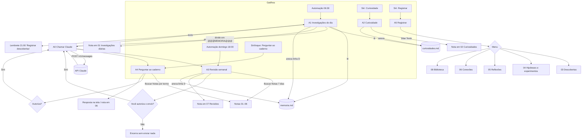

# CODEX — laboratório intelectual pessoal (v1)

> Um caderno de investigação inspirado nos **hábitos visíveis nos cadernos de Leonardo da Vinci**
> (observar, perguntar, desenhar, calcular, experimentar, registrar). Leonardo **não** deixou uma
> metodologia formal escrita; os dez verbos do CODEX são uma síntese nossa, não uma doutrina dele.
> Listas de "princípios de Da Vinci" que circulam (ex.: os 7 princípios de Michael Gelb, 1998) são
> interpretações modernas.

Este diretório contém a versão **mais simples que funciona**: só iPhone + Atalhos + Notas +
Lembretes + uma chave da API do Claude. Sem app próprio, sem servidor, sem banco de dados.

| Arquivo | Conteúdo |
|---|---|
| `README.md` | Arquitetura, fluxograma, decisões, roteiro de evolução |
| `ATALHOS.md` | Tutorial passo a passo de cada atalho e automação, ação por ação |
| `PROMPTS.md` | Todos os prompts (copiar e colar nos atalhos) |
| `OPERACAO.md` | Custos, testes, limitações e alternativas, privacidade |
| `scripts/teste_api.sh` | Teste da chave e do prompt pelo terminal (opcional) |

---

## 1. O que foi verificado (e o que não existe)

| Integração | Situação real | Uso no CODEX |
|---|---|---|
| **Claude ↔ Apple Notas** | **Não existe acesso direto.** O Claude (app, web ou API) não lê nem escreve no Notas. | Quem lê/escreve no Notas são os **Atalhos**, no seu iPhone. O Claude só recebe o texto que o atalho enviar. |
| **Atalhos → Notas** | Ações nativas: *Criar Nota*, *Adicionar à Nota*, *Buscar Notas* (filtra por pasta, corpo, data), *Mostrar Nota*, *Mover Notas para Pasta*. O corpo volta como **texto simples**; notas bloqueadas não são acessíveis. | Criar notas, buscar notas da semana. |
| **Atalhos → API do Claude** | Ação *Obter Conteúdo do URL* faz POST em `api.anthropic.com/v1/messages`. Funciona em qualquer iPhone. | **Motor principal** (opção A). Custo por uso, ~US$ 3–5/mês. |
| **App Claude no iOS** | Expõe a ação **"Ask Claude"** (Siri, Spotlight, Atalhos), iOS 18+, usa o modelo padrão do app e conta no limite da sua assinatura. ([Anthropic](https://support.claude.com/en/articles/10263469-using-claude-app-intents-and-shortcuts-on-ios)) | **Opção B** sem chave de API — teste antes se a resposta volta como variável e se roda em automação com a tela bloqueada. |
| **Apple Intelligence "Usar Modelo"** | iOS 26+: ação *Usar Modelo* (no aparelho, nuvem privada da Apple ou ChatGPT). Exige iPhone compatível com Apple Intelligence. ([Apple](https://support.apple.com/guide/shortcuts/tpg3vrvwmclv), [MacStories](https://www.macstories.net/stories/ios-and-ipados-26-the-macstories-review/8)) | **Opção C** gratuita; qualidade inferior para geração longa e rigor de fontes. |
| **Siri** | Executa qualquer atalho pelo nome ("E aí Siri, *Curiosidade*"). | Captura por voz. |
| **Lembretes / Calendário** | Ações nativas *Adicionar Novo Lembrete*, *Adicionar Novo Evento*. | Lembrete diário de registro; bloco fixo no calendário (manual). |
| **iCloud Drive** | Ações *Obter Arquivo*, *Anexar ao Arquivo de Texto*. Sincroniza entre aparelhos. | **Memória da máquina** (`memoria.md`, `curiosidades.md`). |
| **Automação Pessoal** | "Hora do Dia" com **Executar Imediatamente** (sem confirmação), iOS 17+. | Disparo diário e semanal. |
| Gmail / Telegram / Notion / n8n | Todos possíveis, **nenhum necessário** na v1. | Ver §6 (evolução). |

---

## 2. Arquitetura

Princípio central: **separar o caderno humano da memória da máquina.**

- **Apple Notas = caderno do Leonardo** (seu, rico, desorganizado, manuscrito, desenhos com o Apple Pencil/dedo, fotos).
- **iCloud Drive / `Atalhos/CODEX/` = memória da máquina** (texto puro, uma linha por dia). É barato
  de enviar ao modelo, fácil de ler pelos atalhos e evita repetições. O Notas é ruim como banco de dados
  (o corpo volta sem formatação, sem estrutura); um arquivo `.md` é perfeito.
- **Claude = tutor socrático sem memória**. Cada chamada recebe só o que o atalho envia.
- **Um único atalho fala com a API** (`CODEX · Chamar Claude`). Os outros o chamam. Trocar modelo,
  chave ou regras = editar um só lugar.

```
┌──────────────────────────── iPhone ─────────────────────────────┐
│                                                                  │
│  Siri / Automação / Toque                                        │
│        │                                                         │
│        ▼                                                         │
│  ┌─────────────── Atalhos ───────────────┐                       │
│  │ A1 Investigações do dia   (automático) │──┐                    │
│  │ A2 Curiosidade            (Siri)       │  │ Executar Atalho    │
│  │ A3 Revisão semanal        (automático) │──┤                    │
│  │ A4 Perguntar ao caderno   (sob demanda)│──┤                    │
│  │ A5 Registrar              (Siri)       │  │                    │
│  │ A0 Chamar Claude  ◄────────────────────┼──┘                    │
│  └──────┬───────────────┬─────────────────┘                       │
│         │               │                                         │
│   Notas (pasta CODEX)   iCloud Drive/Atalhos/CODEX                │
│   01…08 subpastas       memoria.md · curiosidades.md              │
│         │                                                         │
│   Lembretes (lista CODEX) · Calendário (bloco "Hora do CODEX")    │
└─────────┼─────────────────────────────────────────────────────────┘
          │ HTTPS (só o texto que o atalho envia)
          ▼
   api.anthropic.com/v1/messages  (Claude Opus 5.5)
```

### Os cinco atalhos

| Atalho | Gatilho | Lê | Escreve | Usa IA? |
|---|---|---|---|---|
| **A0 · Chamar Claude** | chamado pelos outros | — | — | sim (único ponto de contato com a API) |
| **A1 · Investigações do dia** | Automação 06:30 diária | `memoria.md`, `curiosidades.md` | Nota em *01*, linha em `memoria.md`, Lembrete | sim |
| **A2 · Curiosidade** | "E aí Siri, Curiosidade" | — | Nota em *02*, linha em `curiosidades.md` | não (instantâneo, gratuito) |
| **A3 · Revisão semanal** | Automação domingo 18:00 | notas da semana (pastas 01–06), `memoria.md` | Nota em *07*, linha em `memoria.md` | sim, **com sua autorização explícita** |
| **A4 · Perguntar ao caderno** | toque / Siri | notas que contêm o termo buscado | resposta na tela (opcional: nota em *06*) | sim, **com autorização** |
| **A5 · Registrar** | "E aí Siri, Registrar" | — | Nota em *03*, *04*, *05*, *06* ou *08* (menu) | não |
| **A6 · CODEX de hoje** | "E aí Siri, CODEX de hoje" | nota do dia | — (lê em voz alta) | não |
| **A7 · Meu registro** | "E aí Siri, Meu registro" | — | acrescenta o registro falado à nota do dia | não |
| **A8 · Dica** | "E aí Siri, Dica" | nota do dia | — (lê uma dica) | não |

### Como o sistema cumpre cada requisito

| Requisito | Mecanismo |
|---|---|
| Gerar investigações diárias | A1 via Automação Pessoal |
| Criar notas automaticamente | Ação *Criar Nota* (+ *Mover Notas para Pasta* se seu iOS não tiver o campo pasta) |
| Curiosidades por voz | A2 com *Ditar Texto* |
| Consultar anotações, mediante autorização | A3 e A4 mostram **quantas notas e quais títulos** serão enviados e pedem "Enviar / Cancelar" a cada vez |
| Identificar assuntos não explorados / evitar repetição | `memoria.md` registra área + tema + conceitos de cada dia; o prompt obriga a priorizar áreas menos visitadas nos últimos 14 dias e proíbe repetir temas |
| Conexões entre conhecimentos | 1 das 5 investigações diárias é sempre do verbo **Conectar**; a revisão semanal gera o mapa de conexões da semana |
| Revisões semanais | A3 |
| Acompanhar evolução | Linha semanal `S` em `memoria.md` com nível e ajuste (+1/0/−1), baseada no que **você escreveu**, não no que recebeu |
| Livros, artigos, fontes originais | Revisão semanal sugere até 3 obras, com regra de "não inventar" e etiqueta de confiança |
| Exercícios de lógica, matemática, argumentação | Pelo menos 1 por dia (rotação) + 1 exercício na revisão semanal |
| Progressão de complexidade | Nível 1–5 calculado pelo número de dias + ajuste semanal |
| Rigor epistêmico | Toda afirmação recebe uma etiqueta: `[FATO]` `[TEORIA]` `[HIPÓTESE]` `[INTERPRETAÇÃO]` `[CRENÇA]` `[ESPECULAÇÃO]` |

---

## 3. Fluxograma das integrações



Ciclo diário (a "respiração" do sistema):

```
06:30  A1 gera 5 investigações  ──►  você lê no café (5 min)
dia    escolhe 1 a 3 para fazer; captura curiosidades por voz (A2)
21:00  Lembrete: escreve no próprio nota o que descobriu (à mão, desenho, cálculo)
dom    A3 lê o que VOCÊ escreveu, devolve síntese, lacunas, conexões, leituras, ajuste de nível
```

---

## 4. Estrutura no Notas

```
CODEX/
├── 01 — Investigações diárias      ← A1 cria aqui; você escreve abaixo de "Meu registro"
├── 02 — Caderno de curiosidades    ← A2 (voz)
├── 03 — Descobertas                ← A5
├── 04 — Hipóteses e experimentos   ← A5
├── 05 — Reflexões                  ← A5
├── 06 — Conexões entre conhecimentos ← A5 / A4
├── 07 — Revisões de aprendizagem   ← A3
└── 08 — Biblioteca e referências   ← A5 (livros, artigos, citações conferidas)
```

Criação (uma vez, manual, 2 min): Notas → *Pastas* → *Nova Pasta* "CODEX" (no iCloud, não "No iPhone").
Depois, em cada subpasta: segure CODEX → *Nova Pasta*… ou arraste uma pasta para dentro da outra.

Convenções úteis no caderno:
- `#codex/<área>` como **etiqueta** do Notas (ex.: `#codex/logica`) — permite Pastas Inteligentes.
- Escreva primeiro, consulte a IA depois. O CODEX dá perguntas, não respostas.

---

## 5. Decisões de projeto (e por quê)

1. **Motor: app Claude (assinatura Pro) via ação "Ask Claude"** — custo zero além da assinatura.
   Como a ação pode exigir o iPhone desbloqueado, o A1 dispara **ao desligar o alarme da manhã** e
   o A3 só roda depois do seu toque em "Enviar". Se o teste do A0 mostrar que a resposta não volta
   ao atalho, troca-se apenas o A0 para a versão API (US$ 3–5/mês); os outros atalhos não mudam.
2. **Modelo: `claude-opus-5-5`** (o mais capaz da linha Opus, US$ 4 / US$ 20 por milhão de tokens).
   Rigor de fontes e distinção epistêmica pedem o melhor raciocínio; o custo mensal continua baixo.
   Trocar para `claude-sonnet-5-5` ou `claude-haiku-5-5` é uma edição de uma linha em A0, se você quiser.
3. **Fallback de recusa ligado** (`fallbacks: "default"`): se o filtro de segurança recusar algo
   (raro, mas possível em temas de biologia), a API reencaminha para outro modelo automaticamente.
4. **Memória em `.md`, não em JSON** — legível por você, editável no app Arquivos, à prova de erro de
   sintaxe.
5. **Respostas escondidas no fim da nota** ("Dicas — só abra se travar"), nunca a solução completa.
6. **Sem servidor** na v1: nada para manter, nada que quebre à noite.

---

## 6. Roteiro de evolução

| Fase | O que acrescenta | Ferramentas |
|---|---|---|
| **v1 (este)** | 5 atalhos, 2 automações | iPhone + API |
| v1.1 | Etiquetas e Pastas Inteligentes por área; widget com A2/A5 na tela inicial; *Controle* na Central de Controle e no botão de Ação | iOS |
| v2 | Mac com Atalhos rodando a mesma automação (redundância); exportação mensal do `memoria.md` para um "Atlas" em *08* | macOS |
| v2 alt. | **Notion** como base consultável (banco de dados com área, nível, status) se você quiser filtros e gráficos; Notas continua como caderno | Notion API |
| v3 | Geração no servidor, independente do iPhone: **n8n** (agendado) → Claude → envia para **Telegram** (conversa socrática com réplica) e/ou **Gmail** (arquivo) | n8n self-hosted ou cloud |
| v3 alt. | Agente agendado (Claude Managed Agents) que mantém o currículo e conversa por Telegram | API Anthropic |

Nenhuma dessas fases é necessária para começar.
